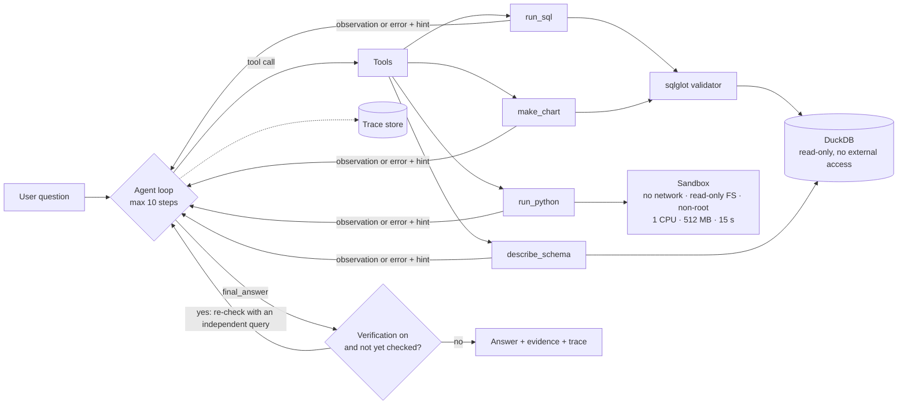

# DataPilot

DataPilot is a data analyst agent. It inspects a CSV, writes SQL or pandas code, runs it in a
sandbox, fixes its own errors and answers with evidence. A benchmark measures how much each
agent feature helps.

**Live demo:** _not deployed yet_ · **Demo GIF:** _placeholder_ (`docs/demo.gif`)

## Architecture



The loop is written by hand on top of native tool calling, in
[`backend/app/agent/loop.py`](backend/app/agent/loop.py). It uses no LangChain or other agent
framework. Each step works like this:

1. The model sees the conversation and either calls a tool or stops.
2. Each tool call is validated against a strict Pydantic schema and executed.
3. The result goes back as a `tool` message.
4. On an error, the model gets the message plus a targeted hint, such as "a column name is
   wrong, check describe_schema". It gets at most 3 retries in a row.
5. The loop ends on `final_answer`, `max_steps`, too many retries, or the per-question cost
   cap.

## Benchmark

There are 69 questions across 3 public datasets
([`benchmark/DATASETS.md`](backend/benchmark/DATASETS.md) lists sources and licenses).
- **By difficulty:** 26 easy, 30 medium, 13 hard.
- **By category:** aggregation (19), filtering (12), time comparison (12), multi-step
  reasoning (11), ambiguous (7) and unanswerable (8).
- **Gold answers** are computed by reviewed SQL in
  [`questions.jsonl`](backend/benchmark/questions.jsonl), using
  [`gold.py`](backend/benchmark/gold.py). They never come from an LLM.
- **Ambiguous questions** accept any listed interpretation, but only if the agent states one.
- **Unanswerable questions** need `answerable=false`.

### Ablation results

> **No benchmark run yet.** This table is filled from `benchmark/results/<run_id>/summary.md`.
> Every number here must trace back to a saved run.

| Config | Success % | Correct refusal % | Avg steps | Avg tokens | Cost / q | p50 s | p95 s |
|---|---|---|---|---|---|---|---|
| single_shot | – | – | – | – | – | – | – |
| loop_no_schema | – | – | – | – | – | – | – |
| loop_schema | – | – | – | – | – | – | – |
| self_correction | – | – | – | – | – | – | – |
| verification | – | – | – | – | – | – | – |
| verification_cheap | – | – | – | – | – | – | – |

Each config is run 3 times and reported as mean ± std. The breakdowns by difficulty and by
category are in `summary.md`.

### Failure analysis

_To be written from `failure_candidates.md` after the run: 5 cases, each with the trace, what
went wrong, and the fix._

## Security design

The sandbox has to be safe to put online, because this demo is public.

| Threat | Defence | Test |
|---|---|---|
| SQL writes (`DROP`, `INSERT`, `COPY`, `ATTACH`, `SET`, `INSTALL`) | sqlglot parses the query and accepts exactly one SELECT, WITH or DESCRIBE. Every node is checked. | `test_sql_security.py` (30 attacks) |
| SQL reading files or URLs (`read_csv('/etc/passwd')`, `FROM 'https://...'`) | Table names must be known tables or CTEs. `read_*`, `glob` and `getenv` are blocked. | same |
| A query that gets past the parser | DuckDB is opened read-only with `enable_external_access=false` and `lock_configuration=true`. | `test_engine_blocks_without_parser` (8 tests that bypass the parser) |
| Slow SQL | `conn.interrupt()` runs on a timer | `test_query_timeout` |
| Python network access | `--network none` locally. On Cloud Run, a VPC with no NAT. | `test_no_network`, `test_no_dns_or_http` |
| Filesystem | Root filesystem and data mount are read-only. Only `/out` and `/tmp` are writable (tmpfs, noexec). Host files are invisible. | `test_*read_only*`, `test_host_files_not_visible` |
| Infinite loop, fork bomb, memory bomb | 15 s wall clock, 64-process limit, 512 MB memory. The whole container or process group is killed. | `test_infinite_loop_times_out`, `test_fork_bomb_contained`, `test_memory_bomb_killed` (each repeated for the Cloud Run backend) |
| Privilege escalation, leaked secrets | User ID 1000, `--cap-drop ALL`, `no-new-privileges`, clean environment | `test_cannot_escalate`, `test_host_env_not_leaked` |
| Flooding the LLM context | Outputs are cut to 4,000 characters, keeping the start and end. SQL results are capped at 200 rows. | `test_huge_output_truncated`, `test_row_limit` |
| Cross-user leak on a reused sandbox instance (a job detaches a process that reads the next job's data) | After every job the sandbox service kills all other processes for its user and empties `/tmp`. It runs one job at a time. Found and fixed during the security review. | `test_server_no_cross_job_leak` |
| Rate limit bypass via a spoofed `X-Forwarded-For` | The limit keys on the last entry, which Cloud Run appends, not the client-supplied first one | `test_rate_limit_ignores_spoofed_forwarded_for` |
| Abuse of the public demo | 15 questions per IP per day, a per-question cost cap, 10 MB upload limit, uploads deleted after 24 h, and a samples-only mode | `test_api.py` |

CI builds the sandbox image and fails if any sandbox security test is skipped.

## Key decisions and trade-offs

- **Custom loop instead of a framework.** It is about 150 lines. Every retry, hint and
  verification step is explicit, and so easy to explain. The cost is building tracing and
  streaming by hand.
- **SQL first.** SQL on DuckDB is faster, cheaper in tokens and much easier to lock down than
  arbitrary Python. Python is only for analysis SQL can't express well.
  `make_chart` covers basic charts without the model writing any code.
- **Two security layers for SQL.** A parser alone is not enough, because a plain `SELECT` can
  read files. The engine lockdown means a parser bug still can't cause damage.
- **Verification is off by default.** It adds at least one extra query and LLM call per
  question. The benchmark measures whether that improves accuracy enough to pay for itself.
- **Cost from env prices.** Token prices come from env vars copied from the provider's pricing
  page. When they are unset, cost shows as 0 instead of a guessed number.
- **Production sandbox is a separate Cloud Run service**, not E2B. See [DEPLOY.md](DEPLOY.md).

## What didn't work, and what I'd do next

- An address-space rlimit of 512 MB broke `import numpy`, because OpenBLAS reserves virtual
  memory up front. The fix was a 1 GiB address-space limit, single-threaded BLAS, and the
  service's own memory limit.
- On Windows, the sandbox tests are flaky when host RAM is exhausted. CI runs them on Linux.
- Next:
  - Postgres for traces
  - a shared rate limiter
  - prompt caching for the system prompt and schema
  - a LangGraph port to compare against the custom loop

## Local setup

Needs `uv`, Docker, Node 22 and an LLM API key. Run these from the repo root:

```bash
cp .env.example .env                                       # set LLM_MODEL, LLM_API_KEY
docker build -t datapilot-sandbox:latest sandbox
cd backend && uv sync && uv run python -m benchmark.download && uv run python -m benchmark.gold
uv run uvicorn app.api.main:app --reload                   # API on :8000
cd ../frontend && npm install && npm run dev               # UI on :3000
```

Other commands:
- **CLI:** `uv run python -m app.agent "Which country has the most invoices?" --dataset benchmark/data/retail --verbose`
- **Tests:** `uv run pytest -q`
- **Benchmark:** `uv run python -m benchmark.run --limit 10 --repeats 1`, which is a pilot to measure cost first. Then run `python -m benchmark.report <run dir>`.
