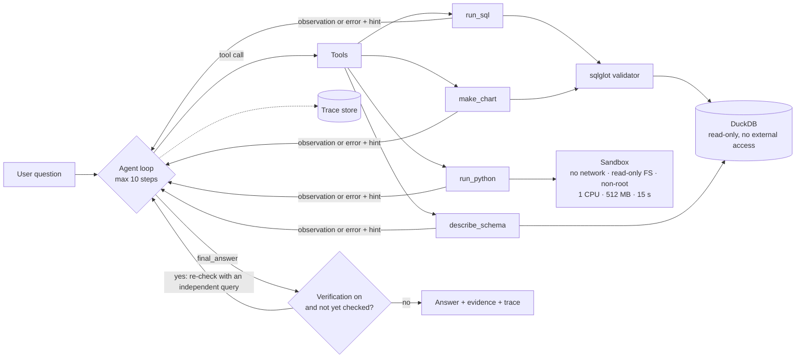
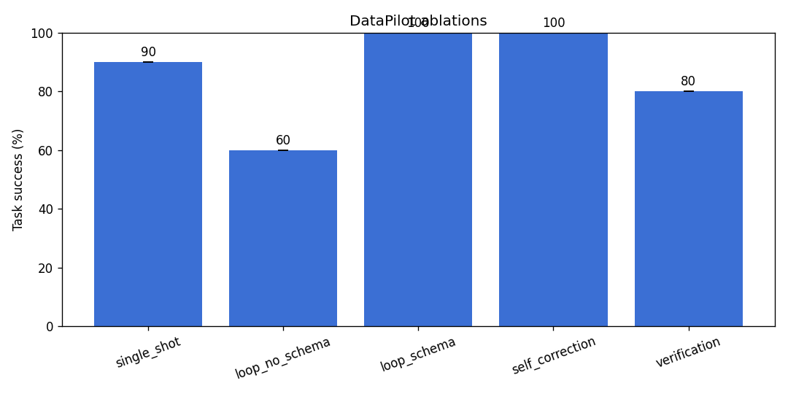

# DataPilot

DataPilot is a data analyst agent. It inspects a CSV, writes SQL or pandas code, runs it in a
sandbox, fixes its own errors and answers with evidence. A benchmark measures how much each
agent feature helps.

**Live demo:** _not deployed yet_ · **Demo GIF:** _placeholder_ (`docs/demo.gif`)

## Architecture



The loop is written by hand on top of native tool calling, in
[`backend/app/agent/loop.py`](backend/app/agent/loop.py). It uses no LangChain or other agent
framework. Each step works like this:

1. The model sees the conversation and either calls a tool or stops.
2. Each tool call is validated against a strict Pydantic schema and executed.
3. The result goes back as a `tool` message.
4. On an error, the model gets the message plus a targeted hint, such as "a column name is
   wrong, check describe_schema". It gets at most 3 retries in a row.
5. The loop ends on `final_answer`, `max_steps`, too many retries, or the per-question cost
   cap.

## Benchmark

There are 69 questions across 3 public datasets
([`benchmark/DATASETS.md`](backend/benchmark/DATASETS.md) lists sources and licenses).
- **By difficulty:** 26 easy, 30 medium, 13 hard.
- **By category:** aggregation (19), filtering (12), time comparison (12), multi-step
  reasoning (11), ambiguous (7) and unanswerable (8).
- **Gold answers** are computed by reviewed SQL in
  [`questions.jsonl`](backend/benchmark/questions.jsonl), using
  [`gold.py`](backend/benchmark/gold.py). They never come from an LLM.
- **Ambiguous questions** accept any listed interpretation, but only if the agent states one.
- **Unanswerable questions** need `answerable=false`.

### Ablation results

**Status: partial.** All runs so far use Gemini's free tier, which allows 15 requests per
minute and 500 requests per day for `gemini-3.5-flash-lite`. That's enough for the pilot
and about half of one full repeat. The 3-repeat run on all 69 questions is still to do (see
"Finishing the benchmark" below). Every number here comes from a saved run under
`backend/benchmark/results/` (`raw.jsonl`, `summary.md`, `traces.sqlite3`). Cost shows as $0
because the free tier is free, not because cost wasn't measured.

**1. Pilot ablation:** 10 questions (`r01`–`r10`, retail) × 5 configs × 1 repeat on
`gemini-3.5-flash-lite`, SQL-only. Run `20261124-002455`.

| Config | Success % | Success % excl. provider errors | Avg steps | Avg tokens | p50 s |
|---|---|---|---|---|---|
| single_shot | 90 | 90 | 1.0 | 71 | 6.5 |
| loop_no_schema | 60 | 60 | 2.5 | 2,976 | 5.7 |
| loop_schema | 100 | 100 | 3.3 | 5,580 | 23.0 |
| self_correction | 100 | 100 | 3.4 | 5,796 | 25.0 |
| verification | 80 | 100 | 4.3 | 8,204 | 41.4 |



**2. Full question set:** 69 questions × 1 repeat, same model. Run `20261124-005158`.
Provider errors are free-tier quota failures, not agent failures; quota-failed runs were
resumed over three days (`--resume`).

| Config | Success % | Success % (excl. provider errors) | Provider errors % | Correct refusal % | Avg steps |
|---|---|---|---|---|---|
| single_shot | 60.9 | 60.9 | 0.0 | 0.0 | 1.0 |
| loop_no_schema | 59.4 | 59.4 | 0.0 | 37.5 | 2.7 |
| loop_schema | 81.2 | 81.2 | 0.0 | 25.0 | 3.4 |
| self_correction | 94.2 | 94.2 | 0.0 | 100.0 | 3.7 |
| verification | 89.9 | 96.9 | 7.2 | 62.5 | 5.4 |

**3. Stronger model:** the verification config on `nvidia/nemotron-3-ultra-550b-a55b:free`
(OpenRouter), same 10 pilot questions. Run `20261124-005425`. It scored 10 / 10, with 5.2
average steps and 13,183 average tokens, against flash-lite's 8 / 10 (both misses were
provider errors). Ten questions is too few to rank the models.

What the data shows so far:
- **Schema inspection matters most.** On the pilot, adding `describe_schema` took the loop
  from 60% to 100%. Without it, the agent tried to discover the schema by querying
  `information_schema`, which the SQL guard blocks, and with self-correction off the first
  rejection ended the run.
- **Single-shot is strong on easy questions and weak everywhere else.** On the full set it
  scores 94.7% on aggregation and 91.7% on filtering. It scores 0% on ambiguous and
  unanswerable questions: it can't say "this column doesn't exist", and it never states an
  interpretation.
- **The pilot is too easy to separate the top three configs.** Questions r01–r10 are mostly
  easy and medium retail questions. The full run on configs 3–5 is needed to show whether
  self-correction and verification add accuracy, and what they cost in tokens.

**Checker fixes after the first run.** Reading the traces found three false negatives in the
answer checker:
- A bare month name ("November") for a "which month of 2011" question.
- A list answer given as `[name, revenue]` rows.
- A table answer with an extra supporting column.

The checker was fixed and tested, and every run was re-graded from its stored answers with
`python -m benchmark.regrade`. That changed 5 verdicts, all from wrong to right. The
original verdict is kept as `correct_at_run` in each `raw.jsonl`.

#### Finishing the benchmark

The runner resumes a run, keeping finished rows and retrying provider errors:

```bash
cd backend
LLM_MODEL=gemini-3.5-flash-lite LLM_RPM=14 uv run python -m benchmark.run --resume benchmark/results/20261124-005158
uv run python -m benchmark.report benchmark/results/20261124-005158
```

Each config costs about 70–300 requests per repeat, so on the free tier the remaining configs
take 2–3 days. For 3 repeats, start a new run with `--repeats 3` and resume it daily, or use
a paid key. A $10 OpenRouter credit also raises its free-model daily limit.

### Failure analysis

Five real failures from the saved traces. Trace ids are in each run's `failure_candidates.md`
and `traces.sqlite3`.

1. **Guessed column names: single_shot, `r06`** ("top 3 countries by revenue, excluding the
   UK").
   - *What happened:* the model wrote `SUM(Quantity * UnitPrice)`, but the real columns are
     `quantity` and `unit_price`. DuckDB raised a Binder Error and even listed
     `retail.unit_price` as a candidate, but single-shot has no second turn to use that hint.
   - *How common:* Binder errors from guessed or invented column names (`UnitPrice`,
     `InvoiceDate`, `date_received`, `cost`) caused 19 of the 27 single-shot failures on the
     full set: 11 on answerable questions and 8 on unanswerable ones.
   - *Fix:* the `describe_schema` step, plus feeding the error back to the model, as
     loop_schema and self_correction do.
2. **Silently wrong because of NULLs: single_shot, `r11`** ("which customer ID has the
   highest revenue").
   - *What happened:* the query grouped by `customer_id` without excluding NULLs, so the
     "customer" with the highest revenue was `NULL`, the 135,080 rows with no customer ID.
     The SQL ran without error and returned a confident wrong answer.
   - *Why it matters:* only schema inspection prevents this; null counts are part of its
     output. Execution errors can't catch it.
3. **Window function applied after the filter: single_shot, `b15`** ("7-day rolling average
   on 2012-12-31").
   - *What happened:* the model put `AVG(cnt) OVER (ROWS 6 PRECEDING)` in a query whose
     `WHERE` had already filtered down to that single day. The window saw one row and returned
     2,729, the day's own count, instead of 1,789.86.
   - *Fix:* again a silent logic error. The verification step, which re-checks the number
     with an independent query, is meant to catch exactly this class.
4. **Tried to read the catalog and was blocked by the guard: loop_no_schema, `r01`.**
   - *What happened:* with no schema tool, the agent ran
     `SELECT * FROM information_schema.tables`. The SQL guard rejects any table not in the
     dataset, by design: catalog and file access are part of what it blocks. With
     self-correction off, that first rejection ended the run. This pattern caused 9 of the 13
     loop_no_schema failures.
   - *Trade-off:* allowing read-only catalog views would help this config, but would widen
     the attack surface. The `describe_schema` tool gives the same information safely.
5. **Invented tool arguments: loop_no_schema, `b18`.**
   - *What happened:* the model called `run_sql` with `{"queries": [...]}`, a list, instead
     of the required `{"query": "..."}`. Strict argument validation
     (`extra="forbid"`) rejected the call, and with self-correction off the run ended.
   - *Fix:* this is the case the self-correction hint is for. The validation error names the
     missing field. A further option is constrained decoding or tool-schema examples in the
     prompt.

Every unanswerable question in the single-shot config failed: the model invented a column
(`cost`, `sales_rep`, `trip_duration`, `disposition`) and the query errored. This is why
the agent's `final_answer` has an `answerable` flag.

## Security design

The sandbox has to be safe to put online, because this demo is public.

| Threat | Defence | Test |
|---|---|---|
| SQL writes (`DROP`, `INSERT`, `COPY`, `ATTACH`, `SET`, `INSTALL`) | sqlglot parses the query and accepts exactly one SELECT, WITH or DESCRIBE. Every node is checked. | `test_sql_security.py` (30 attacks) |
| SQL reading files or URLs (`read_csv('/etc/passwd')`, `FROM 'https://...'`) | Table names must be known tables or CTEs. `read_*`, `glob` and `getenv` are blocked. | same |
| A query that gets past the parser | DuckDB is opened read-only with `enable_external_access=false` and `lock_configuration=true`. | `test_engine_blocks_without_parser` (8 tests that bypass the parser) |
| Slow SQL | `conn.interrupt()` runs on a timer | `test_query_timeout` |
| Python network access | `--network none` locally. On Cloud Run, a VPC with no NAT. | `test_no_network`, `test_no_dns_or_http` |
| Filesystem | Root filesystem and data mount are read-only. Only `/out` and `/tmp` are writable (tmpfs, noexec). Host files are invisible. | `test_*read_only*`, `test_host_files_not_visible` |
| Infinite loop, fork bomb, memory bomb | 15 s wall clock, 64-process limit, 512 MB memory. The whole container or process group is killed. | `test_infinite_loop_times_out`, `test_fork_bomb_contained`, `test_memory_bomb_killed` (each repeated for the Cloud Run backend) |
| Privilege escalation, leaked secrets | User ID 1000, `--cap-drop ALL`, `no-new-privileges`, clean environment | `test_cannot_escalate`, `test_host_env_not_leaked` |
| Flooding the LLM context | Outputs are cut to 4,000 characters, keeping the start and end. SQL results are capped at 200 rows. | `test_huge_output_truncated`, `test_row_limit` |
| Cross-user leak on a reused sandbox instance (a job detaches a process that reads the next job's data) | After every job the sandbox service kills all other processes for its user and empties `/tmp`. It runs one job at a time. Found and fixed during the security review. | `test_server_no_cross_job_leak` |
| Rate limit bypass via a spoofed `X-Forwarded-For` | The limit keys on the last entry, which Cloud Run appends, not the client-supplied first one | `test_rate_limit_ignores_spoofed_forwarded_for` |
| Abuse of the public demo | 15 questions per IP per day, a per-question cost cap, 10 MB upload limit, uploads deleted after 24 h, and a samples-only mode | `test_api.py` |

CI builds the sandbox image and fails if any sandbox security test is skipped.

## Key decisions and trade-offs

- **Custom loop instead of a framework.** It is about 150 lines. Every retry, hint and
  verification step is explicit, and so easy to explain. The cost is building tracing and
  streaming by hand.
- **SQL first.** SQL on DuckDB is faster, cheaper in tokens and much easier to lock down than
  arbitrary Python. Python is only for analysis SQL can't express well.
  `make_chart` covers basic charts without the model writing any code.
- **Two security layers for SQL.** A parser alone is not enough, because a plain `SELECT` can
  read files. The engine lockdown means a parser bug still can't cause damage.
- **Verification is off by default.** It adds at least one extra query and LLM call per
  question. The benchmark measures whether that improves accuracy enough to pay for itself.
- **Cost from env prices.** Token prices come from env vars copied from the provider's pricing
  page. When they are unset, cost shows as 0 instead of a guessed number.
- **Production sandbox is a separate Cloud Run service**, not E2B. See [DEPLOY.md](DEPLOY.md).

## What didn't work, and what I'd do next

- An address-space rlimit of 512 MB broke `import numpy`, because OpenBLAS reserves virtual
  memory up front. The fix was a 1 GiB address-space limit, single-threaded BLAS, and the
  service's own memory limit.
- On Windows, the sandbox tests are flaky when host RAM is exhausted. CI runs them on Linux.
- **Free-tier quotas shaped the benchmark more than the code did.**
  - The `gemini-3.5-flash` alias allows 20 requests per day and `flash-lite` allows 500. A
    3-repeat run of every config is about 3,000 requests.
  - Fixes: a client-side requests-per-minute pacer (`LLM_RPM`), a separate column for
    provider errors in the report, and `--resume` to finish a run across days.
- **Gemini 3 thought signatures.** Gemini 3 rejects the next turn unless each tool call's
  `thought_signature` is sent back. The provider-neutral message format now carries
  provider extras on each tool call.
- Next:
  - Postgres for traces
  - a shared rate limiter
  - prompt caching for the system prompt and schema
  - a LangGraph port to compare against the custom loop

## Local setup

Needs `uv`, Docker, Node 22 and an LLM API key. Run these from the repo root:

```bash
cp .env.example .env                                       # set LLM_MODEL, LLM_API_KEY
docker build -t datapilot-sandbox:latest sandbox
cd backend && uv sync && uv run python -m benchmark.download && uv run python -m benchmark.gold
uv run uvicorn app.api.main:app --reload                   # API on :8000
cd ../frontend && npm install && npm run dev               # UI on :3000
```

Other commands:
- **CLI:** `uv run python -m app.agent "Which country has the most invoices?" --dataset benchmark/data/retail --verbose`
- **Tests:** `uv run pytest -q`
- **Benchmark:** `uv run python -m benchmark.run --limit 10 --repeats 1`, which is a pilot to measure cost first. Then run `python -m benchmark.report <run dir>`.
